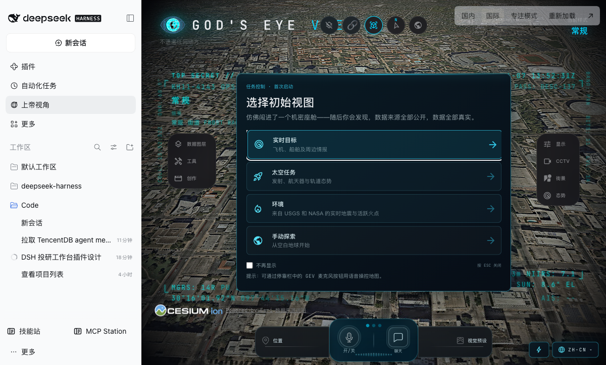
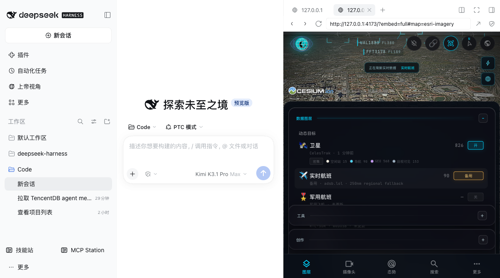

# God’s Eye View for DeepSeek Harness

[](https://www.npmjs.com/package/@wilshi/dsh-gods-eye-view)
[](LICENSE)

在 DeepSeek Harness（DSH）中央主面板中运行完整的 [God’s Eye View](https://github.com/bilawalsidhu/gods-eye-view)，并加入 DSH Agent 控制、进程托管、国内/国际地图模式和专注模式。

**不是简化地球，也不是浏览器标签页或静态截图。**



## 功能

- 完整上游应用：实景影像、航班、卫星、地震、CCTV、街景、交通、天气、基础设施、目标跟踪、驾驶舱和视觉样式等。
- **DSH 主面板内嵌**：无浏览器标签、地址栏或分栏外壳。
- **Agent 工具 `gods_eye_view`**：相机飞行、图层、地图源、视觉样式、目标跟踪和地图标注。
- **DSH 适配**：国内 OSM / 国际 Esri、专注模式、重新加载、系统浏览器打开、状态提示和进程托管。
- **官方视图协议桥**：Host 工具入队 → Client 选择主面板 → 上游 `gev:ready` → `gev:view` → `gev:view-applied` 回执。
- 自动拉取固定上游 commit 和依赖；已有服务不会被误杀。



## 安装

要求：

- DeepSeek Harness 兼容的 Cordis/插件运行环境。
- Node.js **24.x 或 26.x**。
- Git，以及安装时访问 GitHub、npm 和公共数据服务的网络。

在 DSH 插件管理器中安装 **`@wilshi/dsh-gods-eye-view`**。如果 DSH 提示批准安装脚本，需要允许：安装脚本只执行本项目的 `scripts/install-upstream.mjs`，拉取上游、应用 DSH 补丁并运行 `npm ci`。

也可以手动安装：

```bash
npm install @wilshi/dsh-gods-eye-view
```

安装后点击左侧 **“上帝视角”**。插件检查 `http://127.0.0.1:4173/`，未运行时自动启动。

## 使用

- **国内 / 国际**：切换 OSM / Esri 影像。
- **专注模式**：收起 DSH 左侧栏。
- **重新加载**：重新载入上游界面。
- **系统浏览器打开**：适合语音、下载和复杂 GPU 场景。

直接对 Agent 说：

> 用上帝视角飞到上海，开启卫星图层。

对应工具视图：

```json
{
  "camera": {
    "lat": 31.2304,
    "lon": 121.4737,
    "altitude_m": 1200000,
    "heading_deg": 0,
    "pitch_deg": -90
  },
  "layers": ["satellites"],
  "style": "normal",
  "map": "esri-imagery"
}
```

工具参数还支持 `follow`、`annotations` 和其他 `camera` 字段。视图会排队并异步应用；结果由上游实际回执确认。

## 可选服务与密钥

基础启动无需 API Key。Google Photorealistic 3D、Cesium ion 地形、AI 语音、AIS 船舶、NASA FIRMS、TomTom 等可选服务，请在原项目的 **POWER UP / Provider Settings** 中配置。

**不要**把密钥提交到本仓库或写入公开 `cordis.patch.yml`。

## 国内网络说明

代码和依赖在本地运行，但 Esri、OSM、Google、Cesium ion、OpenSky、CelesTrak 等仍访问各自服务商。中国大陆可达性取决于运营商和上游状态。上游支持的部分备用源（例如 adsb.lol）会明确显示“备用”，不会把备用源冒充主源。

## 配置

`cordis.patch.yml` 默认仅设置：

```yaml
port: 4173
```

可选 `upstreamDir`、`nodePath` 用于自定义上游目录和 Node 24/26 可执行文件。默认上游位于安装包的 `vendor/gods-eye-view`。

已有服务会被直接使用且**不会被终止**；只有插件自己启动的进程才在插件卸载时终止。

## 开发与验证

```bash
npm install --ignore-scripts
npm run setup
npm test
npm run check
```

`vendor/` 是安装生成目录，不提交到 Git。测试包括视图校验、进程复用、缺失依赖错误、托管进程启动与卸载。

## 安全边界

- 上游仅监听 `127.0.0.1`。
- `?embed=full` 只允许 `GEV_EMBED_FRAME_ANCESTORS` 指定的 DSH origin 嵌入。
- 上游 `?embed=1` 的纯地球行为不变；`?embed=full` 同时保留完整 UI 与视图协议。
- 当前使用 Vite 本地开发服务，**不要直接暴露到公网**。
- 公开数据可能延迟、不完整或错误，不可用于导航、应急响应或其他安全关键决策。

## 许可证

本项目采用 [MIT License](LICENSE)。上游 God’s Eye View 的许可证见 [UPSTREAM-LICENSE.md](UPSTREAM-LICENSE.md)。上游数据、影像和模型有各自条款，见 [THIRD_PARTY_NOTICES.md](THIRD_PARTY_NOTICES.md) 和上游 `DATA_SOURCES.md`。
